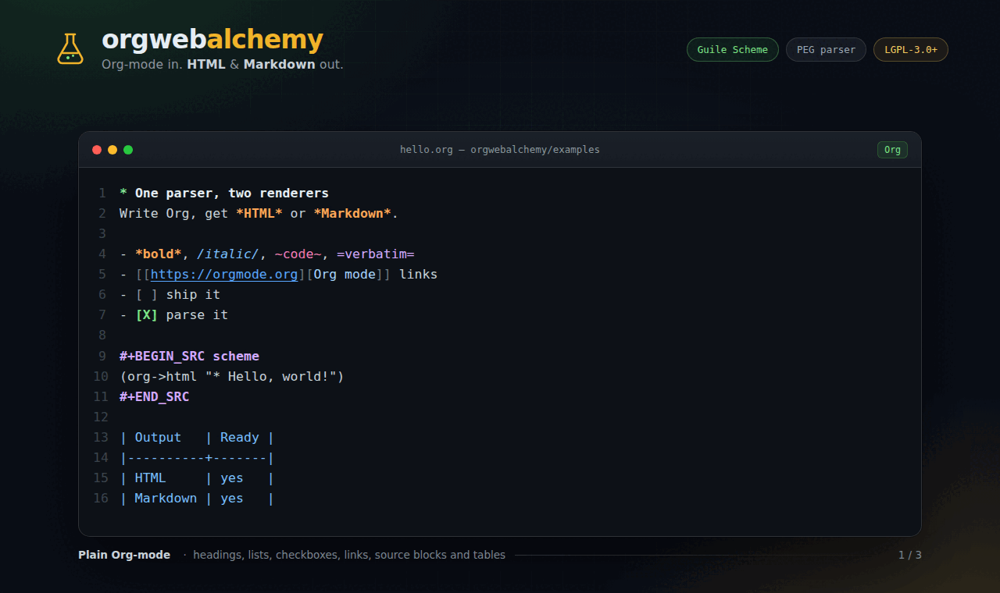
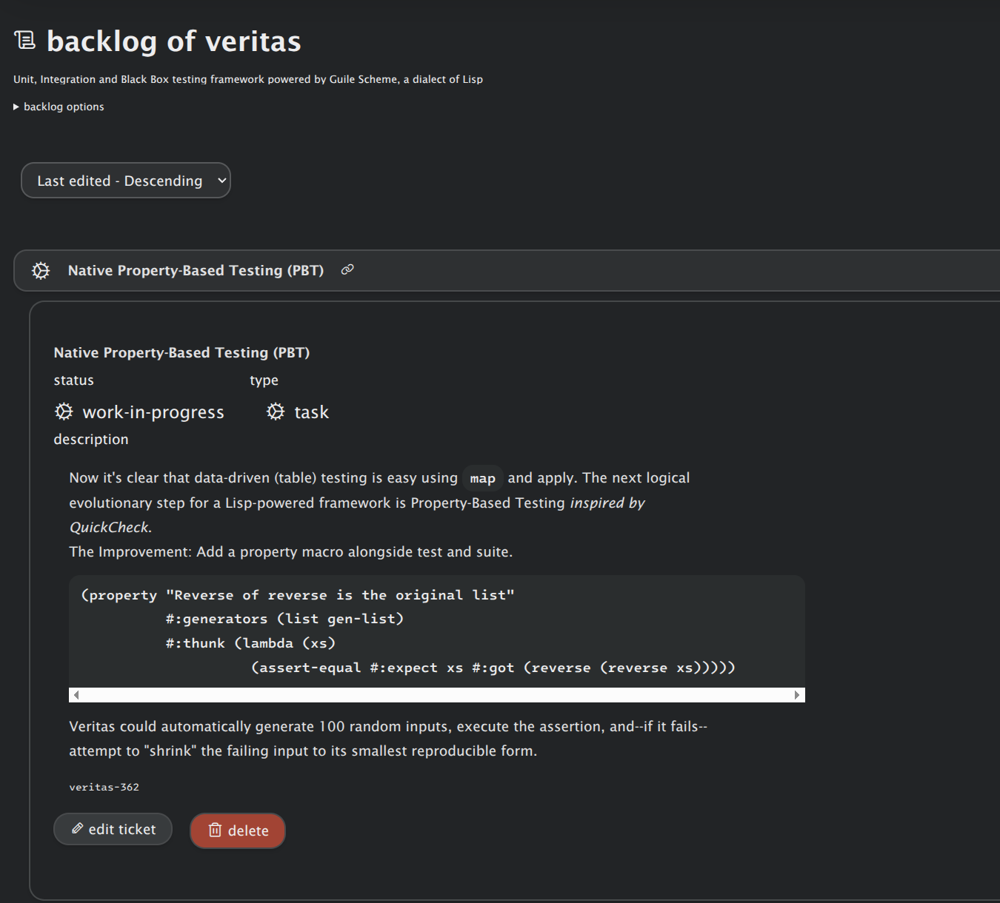

#+title: OrgWebAlchemy
#+subtitle: A Guile Scheme library for Org-mode
#+author: Josep Bigorra
#+email: jjbigorra@gmail.com
#+language: en
#+options: toc:nil num:nil
#+description: A Guile Scheme library that parses Org-mode with a PEG grammar and renders clean HTML, Markdown, or SXML.
#+keywords: Org-mode, Guile Scheme, PEG, HTML, Markdown, static site generator, free software

-[[https://jointhefreeworld.org/ggg/dist/scheme-guile.svg]] [[https://jointhefreeworld.org/ggg/dist/gnu-guix.svg]]
-[[https://jointhefreeworld.org/ggg/dist/license-lgpl3+.svg]]    [[https://jointhefreeworld.org/ggg/dist/license-fdl13+.svg]]

#+begin_quote
*Org-mode in. HTML and Markdown out.*

OrgWebAlchemy is a small, dependency-light [[https://www.gnu.org/software/guile/][Guile Scheme]] library that parses Org-mode documents with a real [[https://en.wikipedia.org/wiki/Parsing_expression_grammar][PEG grammar]] and renders them to clean *HTML*, *Markdown*, or *SXML*. Write your notes, documentation, or blog in Org; publish them from Scheme, with the structure and the CSS you want.
#+end_quote

#+caption: One Org document, rendered by both renderers. Generated from [[file:examples/hello.org][examples/hello.org]] with [[file:examples/demo.scm][examples/demo.scm]].
#+attr_html: :width 100%

- *What it is* :: a parser and a pair of renderers for Org-mode, written in Guile Scheme and built around a Parsing Expression Grammar.
- *Who it is for* :: Scheme hackers, static-site authors, wiki and notebook builders, tool makers, and anyone who keeps writing in Org but wants to publish with a library instead of an Emacs export.
- *Why you will like it* :: it understands real Org rather than a regex-shaped subset, it gives every renderer the same AST, and it lets your CSS classes -- not ours -- decide how the output looks.
- *Freedom* :: LGPL-3.0-or-later for the code, FDL-1.3-or-later for this documentation. No account, no telemetry, no build service required.

*Jump to:* [[#installation][Installation]] · [[#quick-start][Quick start]] · [[#configuration][Configuration]] · [[#supported-org-features][Supported features]] · [[#api-overview][API]] · [[#how-it-works][How it works]] · [[#benchmarks][Benchmarks]] · [[#contributing][Contributing]]

The short version, if you already have Guile and this checkout on your load path:

#+begin_src scheme
(use-modules (orgwebalchemy html)
             (orgwebalchemy markdown))

(org->html "This is ~test~ code.")
;; => "This is <code>test</code> code."

(org->markdown "This is ~test~ code.")
;; => "This is `test` code."
#+end_src

And the full technical API documentation lives here:

https://jointhefreeworld.org/api-docs/orgwebalchemy/API.html

---------------------

* Why OrgWebAlchemy?
:PROPERTIES:
:CUSTOM_ID: why-orgwebalchemy
:END:

Org mode is a wonderful place to write. It is a less wonderful thing to parse.

A real Org document is not a pile of lines that each match a regular expression. It has nested lists, source blocks, description lists, links whose meaning depends on their target, inline markup with escaping rules, and constructs that end only when the surrounding context says they end. Tools built from regex substitutions tend to accumulate special cases until the regexes describe the bugs in the parser rather than the language.

OrgWebAlchemy takes a different route:

#+begin_example
Org text
   |
   v
 PEG grammar
   |
   v
 AST
   |        |
   v        v
 HTML     Markdown
 renderer renderer
#+end_example

The grammar describes the language. The parser produces a structured tree. The renderers turn that tree into output. Syntax stays in the parser and presentation stays in the renderers, which is why the HTML and Markdown back ends can agree about what a link, a figure, or a heading means.

Here is what that buys you, depending on what you are building:

| If you want to...                              | Reach for...                                            |
|------------------------------------------------+---------------------------------------------------------|
| Turn an Org string into an HTML fragment       | ~org->html~                                             |
| Turn an Org string into Markdown               | ~org->markdown~                                         |
| Parse once and render more than once           | ~org->ast~, then ~org-ast->html~ or ~org-ast->markdown~ |
| Post-process the document tree with SXML       | ~org->sxml~, ~org-ast->sxml~                            |
| Style every element for your design system     | the HTML class parameters                               |
| Embed Org rendering in a static site generator | the three modules below                                 |
| Understand how the parser works                | [[#how-it-works][the PEG section]]                      |

OrgWebAlchemy is a library, not an application. It has no opinion about your web framework, your static-site generator, your templating language, or your CSS. It gives you a correct tree and clean output; the rest is yours.

---------------------

* Features
:PROPERTIES:
:CUSTOM_ID: features
:END:

- *One parser, two renderers* :: ~org->html~ and ~org->markdown~ are built on the same parsed AST. They cannot drift apart on what a link target, a heading anchor, a figure, or a named element means.
- *A real AST* :: ~org->ast~ returns a tree of nodes, not a string that needs to be reparsed. Inspect it, transform it, or render it yourself.
- *HTML with class hooks everywhere* :: every element the HTML renderer emits takes its CSS classes from a Guile parameter. Bootstrap, Tailwind, Bulma, hand-written CSS -- your call.
- *Markdown without hand-waving* :: underlines, superscripts, subscripts, description lists, and footnotes fall back to inline HTML or the Markdown conventions that preserve their meaning.
- *Links that know where they go* :: link targets are classified once, in the parser: external URLs, ~file:~ links, bare paths, ~#custom-id~ links, ~*Heading~ links, image links, and ~::search~ suffixes.
- *Figures and named elements* :: ~#+CAPTION:~ and ~#+NAME:~ make figures and addressable elements; ~[[fig:name]]~, ~[[tbl:name]]~, and bare-name links resolve to them in both renderers.
- *Org, not a toy subset* :: headings with TODO keywords, priorities and tags; nested mixed lists; checkboxes; tables with empty cells; source, example, quote, verse, center and export blocks; footnotes; fixed-width lines; separators; comments; and more.
- *SXML when you need it* :: ~org->sxml~ and ~org-ast->sxml~ let you post-process the tree with ~(sxml simple)~ or any SXML tool you already use.
- *Small footprint* :: no runtime dependencies beyond Guile's standard library. The whole library is three modules.
- *Tested and measured* :: unit suites cover the grammar and both renderers; equivalence checks compare parser revisions over tens of thousands of inputs; benchmarks track parse and render cost.
- *Free software* :: LGPL-3.0-or-later. Use it in free and non-free programs, improve it, share it.

---------------------

* How it works: parsing Org with PEG
:PROPERTIES:
:CUSTOM_ID: how-it-works
:END:

** What is a PEG? (Parsing Expression Grammars)

Read a [[https://en.wikipedia.org/wiki/Parsing_expression_grammar][nice explanation of PEG on Wikipedia]] or dive directly into the Guile Scheme ~(ice-9 peg)~ module and accompanying [[https://doc.guix.gnu.org/guile/3.0.9/en/html_node/PEG-Parsing.html][fantastic tutorial by GNU]].

Org mode looks deceptively simple. At first glance, parsing Org seems like a job for a handful of regular expressions:

#+begin_example
^\\*+ +.*$
^- +.*$
^#+BEGIN_SRC
^#+END_SRC
#+end_example

For a tiny subset of Org, that can work reasonably well. The thing is, real Org documents are not just collections of lines matching regular expressions.

They contain nested structures, different kinds of lists, source blocks, descriptions, links, inline markup, escaping rules, and syntax where the meaning of a piece of text depends on its surrounding context.

This is where =orgwebalchemy= uses *Parsing Expression Grammars (PEGs)* and their power to parse correctly and convert powerfully to an AST for later rendering (to different formats).

** PEG instead of regex soup

A parser built from increasingly large regular expressions tends to become a collection of special cases. Eventually the regular expressions stop describing the language and start describing the bugs in the parser.

#+begin_example
if this matches, but not when that follows it,
unless we are inside a source block,
except when it is a description,
and don't consume the newline,
unless the previous line was a list item...
#+end_example

PEG gives us a different approach.

Instead of asking:

#+begin_quote
"Can I find a string that looks vaguely like this?"
#+end_quote

we describe the structure of the language:

#+begin_quote
"An Org document consists of elements. An element can be a heading, a
paragraph, a list item, a source block, or another construct."
#+end_quote

The grammar becomes executable and testable documentation. This is also thanks to Guile Scheme's great ~(ice-9 peg)~ implementation, which supports traditional formal PEG syntax, but also PEG as S-expressions. Other technologies and implementations can achieve similar things, but not, I would argue, with the same elegance.

For example, a simplified grammar can express the structure directly:

#+begin_src scheme
(define-peg-pattern element body
  (or empty-line
      heading
      src-block
      unordered-item
      ordered-item
      paragraph))
#+end_src

And a list item can be described in terms of its components:

#+begin_src scheme
(define-peg-pattern unordered-item all
  (and list-bullet
       ws
       item-content
       nl))
#+end_src

This is much closer to the actual language than a regular expression trying to match an entire document.

** PEG gives structure

One of the most important advantages of PEG is that parsing can produce a structured representation of the input.

For example, this:

#+begin_example
- name :: Joe
#+end_example

can become something conceptually similar to:

#+begin_src scheme
(org-list
 (desc-item
  (desc-key "name")
  (line-content "Joe")))
#+end_src

The parser is therefore not merely answering:

#+begin_example
"Does this line match?"
#+end_example

It is answering:

#+begin_example
"What is this thing, and what are its parts?"
#+end_example

Once we have an AST, rendering to HTML, Markdown or others becomes a separate, much simpler problem:

#+begin_example
Org text
   |
   v
 PEG grammar
   |
   v
 AST
   |        |
   v        v
 HTML     Markdown
 renderer renderer
#+end_example

This separation keeps the parser concerned with *syntax* and the renderer concerned with *presentation*.

** Context matters

Real-world Org syntax contains constructs that cannot safely be parsed by looking at one regular expression in isolation.

For example, a description list (also, think about nested lists and how that would be a nightmare with regex):

#+begin_example
- name :: Josep
- project :: orgwebalchemy
- language :: Scheme
#+end_example

must not accidentally consume the following list item as part of the description key.

Similarly, a source block has different parsing rules from ordinary paragraph text:

#+begin_example
#+BEGIN_SRC scheme
(display "Hello")
#+END_SRC
#+end_example

PEG lets us express these boundaries explicitly.

** PEG is composable

Another reason PEG works particularly well and scales is that grammars can be built from smaller grammars.

We can have one level describing the document:

#+begin_example
document
  -> elements
       -> heading
       -> paragraph
       -> list
       -> source block
#+end_example

And another level describing inline markup:

#+begin_example
inline content
  -> text
  -> *bold*
  -> /italic/
  -> ~code~
  -> =verbatim=
  -> _underline_
  -> [[links]]
  -> escaped characters
#+end_example

The block parser does not need to understand every inline construct.
Likewise, the inline parser does not need to understand headings or lists.

This gives us small, composable grammars instead of one enormous regular expression.

** PEG is not magic

Using PEG does not mean that Org mode suddenly becomes easy to parse.

Org is a large language with many historical conventions, and =orgwebalchemy= does its best to comply.

The important difference is that when the grammar grows, we can extend the grammar itself rather than adding another pile of increasingly fragile regular-expression substitutions.

** Why not just use regex?

Regular expressions are still useful.

They are excellent for small, local lexical problems:

- recognizing a simple token;
- validating a small piece of text;
- finding a simple pattern;
- processing already-tokenized data.

The problem starts when regular expressions are used as a substitute for a parser.

Once the language contains nesting, alternatives, boundaries, context,
escaping, and multiple interacting constructs, a collection of regexes
quickly becomes difficult to reason about.

PEG gives us:

- *explicit grammar* instead of scattered matching rules;
- *ordered alternatives* instead of ambiguous regex chains;
- *composition* instead of one giant expression;
- *boundaries* instead of accidental over-consumption;
- *structured AST output* instead of strings that need to be reparsed;
- *maintainability* instead of an ever-growing collection of special cases.

In short:

#+begin_quote
Regexes are great at recognizing pieces of text.

PEGs are great at describing a language.
#+end_quote

And Org mode is a language. That is why =orgwebalchemy= uses PEG.

---------------------

* Configuration
:PROPERTIES:
:CUSTOM_ID: configuration
:END:

** Styling HTML with class parameters

The HTML renderer emits semantic elements with no styles attached. Every element reads its CSS classes from a Guile parameter, so one document can be styled for any design system without touching the parser:

#+begin_src scheme
(use-modules (orgwebalchemy html))

(parameterize ((heading-classes
                (lambda (level)
                  (case level
                    ((1) '("text-4xl" "font-bold"))
                    ((2) '("text-2xl" "font-semibold"))
                    (else '("text-base")))))
               (paragraph-classes '("leading-relaxed" "mb-4"))
               (link-classes '("underline" "text-blue-600")))
  (org->html "This paragraph is *bold*.\n"))
;; => "
This paragraph is <strong>bold</strong>.
"
#+end_src

Each parameter is a list of class-name strings, except ~heading-classes~, which is a procedure of the heading level so that each level can be styled on its own. Parameters are dynamic: use ~parameterize~ to scope a change to one render call, or set them once for your program.

- *Inline* :: ~link-classes~, ~image-classes~, ~code-classes~, ~italic-classes~, ~bold-classes~, ~underline-classes~, ~strike-classes~, ~superscript-classes~, ~subscript-classes~.
- *Blocks* :: ~paragraph-classes~, ~code-block-classes~, ~quote-block-classes~, ~example-block-classes~, ~verse-block-classes~, ~center-block-classes~, ~separator-classes~, ~keyword-classes~, ~fixed-width-classes~.
- *Lists* :: ~unordered-list-classes~, ~unordered-list-item-classes~, ~ordered-list-classes~, ~ordered-list-item-classes~, ~description-list-classes~, ~description-term-classes~, ~description-detail-classes~, ~checkbox-classes~.
- *Tables* :: ~table-classes~, ~table-header-row-classes~, ~table-header-cell-classes~, ~table-row-classes~, ~table-cell-classes~.
- *Media* :: ~image-classes~, ~figure-classes~, ~figure-caption-classes~.
- *Headings* :: ~heading-classes~ (a procedure of the heading level).

All parameters are exported by ~(orgwebalchemy html)~ and default to the empty
class list, except ~heading-classes~, whose default is a procedure that returns
the empty list for every level.

** What is deliberately not configurable

The Markdown renderer has no class parameters: Markdown has no styling of its own. Its job is to preserve structure and meaning, falling back to inline HTML only where Markdown has no equivalent. Link classification, figure folding, and name resolution also live in the parser, so the two renderers always agree about them.

** Heading anchors

Every heading carries an ~id~, and a ~[[*Heading][link]]~ points at the same anchor. Both are produced by ~org-anchor~, so they cannot drift apart:

#+begin_src scheme
(use-modules (orgwebalchemy html))

(org->html "* My First Section\nSee [[*My First Section][up there]].\n")
;; => "<h1 id=\"my-first-section\">My First Section</h1>
See <a href=\"#my-first-section\">up there</a>.
"
#+end_src

A title with nothing anchor-worthy in it gets no ~id~ at all. ~heading-id~ is the helper that builds the attribute.

---------------------

* Supported Org features
:PROPERTIES:
:CUSTOM_ID: supported-org-features
:END:

Org is a large language. OrgWebAlchemy aims to handle the constructs people actually write, and to be honest about the edges it does not reach yet. The supported surface is:

- *Block elements* :: headings, paragraphs, lists, tables, source/example/quote/verse/center/export blocks, comments, fixed-width lines, separators, keywords, footnotes.
- *Inline markup* :: bold, italic, underline, strikethrough, inline code, verbatim, superscript, subscript, forced line breaks, escaped markup.
- *Links and media* :: links with and without descriptions, bare URLs, image links, figures, named elements, ~file:~ and ~#custom-id~ targets, ~*Heading~ links, ~::search~ suffixes.
- *Output* :: HTML fragments, SXML, Markdown, inline-only rendering, configurable CSS classes for HTML.

** Block elements

- Headings (lines starting with one or more ~*~), including an optional TODO keyword,
  priority (~[#A]~) and tags (~:tag1:tag2:~)
- Paragraphs (any "non-special" text)
- Unordered, Ordered and Description lists (with any level of nesting), with
  checkbox items (~- [ ]~ and ~- [X]~).  The three kinds may be mixed freely:
  one list may change its bullet type part-way through, and a nested list may
  use a different kind from its parent
- Tables, including empty cells: ~| a || b |~ is a row of three cells in both
  renderers, the middle one empty, and a line that is nothing but its closing
  bar (~|~ on its own) is a row of one empty cell
- ~#+begin_src~, with or without a language (a block written without one still
  renders as a source block, just without a language class)
- ~#+begin_example~
- ~#+begin_quote~ (with nested parsing)
- ~#+begin_verse~ and ~#+begin_center~
- ~#+begin_export html~ : Org syntax is parsed by your PEG grammar, but raw HTML export blocks bypass the Org inline parser and are emitted as trusted literal output
- Keywords and in-buffer settings (~#+TITLE: ...~, ~#+AUTHOR: ...~, ...)
- Comments: single lines beginning with ~#~ and ~#+begin_comment~ blocks
- Fixed-width lines (~: text~)
- Horizontal separators (~--------~) five or more dashes
- Footnotes: references (~[fn:label]~), definitions (~[fn:label: text]~) and
  inline footnotes (~[fn::text]~)

** Inline markup

- Italic, Bold, Underline, Strikethrough, Inline Code and Verbatim
- Superscript and subscript in their braced form (~x^{2}~, ~H_{2}O~)
- Forced line breaks (~\\~ at the end of a line) and escaped markup (~\*~)
- Links with and without description (with nested parsing) and bare URLs
- Links to images, which render as images in both renderers

** Links and images

An Org link is not just a URL in brackets: its target says what kind of link
it is, and both renderers have to agree on what to do with each kind.  Instead
of letting each renderer re-read the target, =orgwebalchemy= classifies the
target once, in the parser:

#+begin_src scheme
(use-modules (orgwebalchemy peg))

(org-link-parts "https://example.org/a")   ;; => (https . "//example.org/a")
(org-link-parts "file:photo.png")          ;; => (file . "photo.png")
(org-link-parts "notes.org")               ;; => (file . "notes.org")
(org-link-parts "#custom-id")              ;; => (internal . "custom-id")
(org-link-parts "*My Section")             ;; => (heading . "My Section")
(org-link-protocol "mailto:me@example.org")  ;; => mailto
(org-link-path "file://images/a.png")        ;; => "images/a.png"
(org-link-href "*My Section")                ;; => "#my-section"
(org-link-display "#custom-id")              ;; => "custom-id"
(org-link-search "notes.org::*Heading")      ;; => "*Heading"
#+end_src

The protocol is the URL scheme when the target has one of its own, ~file~ for a
~file:~ link or a bare path, ~internal~ for a ~#custom-id~ link, and ~heading~
for a ~*Heading~ link.  ~org-image-link?~ then answers the question the image
rendering needs:

- a ~file:~ link (or bare path) is an image when its extension is one of ~png~,
  ~jpg~, ~jpeg~, ~gif~, ~svg~, ~webp~, ~avif~, ~bmp~, ~tiff~, ~tif~ or ~ico~,
  matched case-insensitively and with any query string ignored, so
  ~photo.jpeg?raw=1~ counts;
- a ~data:image/...~ URI counts as well;
- a ~::search~ suffix (~file:notes.org::*Heading~) is kept out of the path, so
  the href that comes out is still a valid file name, and ~org-link-search~
  hands back the part that was set aside;
- a Windows path such as ~C:/tmp/x.txt~ is not mistaken for a link with a scheme
  called ~c~, because a scheme has to be lower-case.

Both renderers then follow that single answer:

| Org                           | HTML                                         | Markdown                                    |
|-------------------------------+----------------------------------------------+---------------------------------------------|
| ~[[file:photo.png][a photo]]~ | ~~      | ~~                     |
| ~[[images/diagram.svg]]~      | ~~ | ~~ |
| ~[[file:notes.org][notes]]~   | ~<a href="notes.org">notes</a>~              | ~[notes](notes.org)~                        |
| ~[[#custom-id][there]]~       | ~<a href="#custom-id">there</a>~             | ~[there](#custom-id)~                       |
| ~[[*My Section][up]]~         | ~<a href="#my-section">up</a>~               | ~[up](#my-section)~                         |
| ~[[https://gnu.org][GNU]]~    | ~<a href="https://gnu.org">GNU</a>~          | ~[GNU](https://gnu.org)~                    |

A heading link needs somewhere to land, so every heading carries its anchor as
an ~id~:

#+begin_src scheme
(use-modules (orgwebalchemy html))
(org->html "* My First Section\nSee [[*My First Section][up there]].\n")
;; "<h1 id=\"my-first-section\">My First Section</h1>
See <a href=\"#my-first-section\">up there</a>.
"
#+end_src

The heading's id and the link's fragment are both ~org-anchor~ of the same
title, so they cannot drift apart.  ~heading-id~ builds the attribute, and
~image-classes~ is the parameter that styles what an ~~ gets, like every
other element class.

** Figures

Org gives the element that follows a ~#+CAPTION:~ or ~#+NAME:~ keyword a
caption and a name.  When that element is a link to an image, the caption, the
name and the image are one thing: a *figure*.  The parser folds them together,
so both renderers are handed a single element, and the name a ~[[fig:name]]~
link points at is the very id the figure carries:

#+begin_src scheme
(use-modules (orgwebalchemy html))
(use-modules (orgwebalchemy markdown))

(org->html "#+NAME: fig:arch\n#+CAPTION: The architecture\n[[file:diagram.png][a diagram]]\n")
;; "<figure id=\"fig:arch\"><figcaption>The architecture</figcaption></figure>"

(org->markdown "#+NAME: fig:arch\n#+CAPTION: The architecture\n[[file:diagram.png][a diagram]]\n")
;; "\n\n\n\n*The architecture*\n\n"
#+end_src

A ~[[fig:arch]]~ link is an internal link, so it becomes the fragment
~#fig:arch~ and lands on the id the figure carries:

#+begin_src scheme
(org->html "#+NAME: fig:arch\n#+CAPTION: The arch\n[[file:a.png]]\n\nSee [[fig:arch]].\n")
;; "<figure id=\"fig:arch\"><figcaption>The arch</figcaption></figure>
See <a href=\"#fig:arch\">fig:arch</a>.
"
#+end_src

Markdown has no ~figure~ element, so a figure becomes its image, its caption as
an emphasised line, and -- when it has a name -- an explicit anchor for the
cross-references, which is what the example above shows.

What counts as a figure is deliberately narrow: the keywords have to come
immediately before a paragraph holding exactly one image link and nothing else.
A caption before a table, before a non-image link, before a paragraph with any
other text, or before a link to an image elsewhere (~https://.../a.png~) stays
an ordinary keyword line -- a ~#+CAPTION:~ in front of one of those describes an
element this parser does not caption yet, while the ~#+NAME:~ in front of it is
the *Named elements* case below.  Several ~#+CAPTION:~ lines join in document order,
one ~#+NAME:~ line gives the figure its id, and ~figure-parts~ returns
~(name caption target description)~ with ~#f~ for every part the figure does
not have.  ~figure-classes~ and ~figure-caption-classes~ style the element.

** Named elements

A figure is the image case of a more general rule: ~#+NAME:~ names the element
that follows it.  Every element that renders as something a link can land on
can be named -- a table, a source or example block, a quote, verse or center
block, an export block, a list, a separator and a paragraph:

#+begin_src scheme
(use-modules (orgwebalchemy html))
(use-modules (orgwebalchemy markdown))

(org->html "#+NAME: tbl:users\n| Users | 1024 |\n")
;; "<table id=\"tbl:users\"><tbody><tr><td> Users </td><td> 1024 </td></tr></tbody></table>"

(org->markdown "#+NAME: tbl:users\n| Users | 1024 |\n")
;; "\n\n| Users | 1024 |\n| --- | --- |\n\n"
#+end_src

HTML has an element to put the id on, so the id goes on it; Markdown has none
on a table or a block, so the same name becomes an explicit anchor, exactly as
it does for a figure.  The id is the name, verbatim, so the name does not have
to follow any convention for the link to work.

A link to a named element resolves in either of the two ways Org resolves a
cross-reference:

- a target that already *is* a fragment -- ~#custom-id~, a ~fig:~, ~tbl:~,
  ~tab:~, ~lst:~ or ~eq:~ name -- is classified as one by the link classifier,
  and lands on the element's id;
- a bare target that is exactly the name of an element of the same document is
  resolved when the document's inline text is parsed, so ~[[tbl:users]]~ and
  ~[[notes]]~ both point at the element they name:

#+begin_src scheme
(org->html "#+NAME: tbl:users\n| Users | 1024 |\n\nSee [[tbl:users]].\n")
;; "<table id=\"tbl:users\"><tbody><tr><td> Users </td><td> 1024 </td></tr></tbody></table>
See <a href=\"#tbl:users\">tbl:users</a>.
"

(org->html "#+NAME: notes\n#+BEGIN_QUOTE\n(x)\n#+END_QUOTE\n\nSee [[notes]].\n")
;; "<blockquote id=\"notes\">(x)</blockquote>
See <a href=\"#notes\">notes</a>.
"
#+end_src

The same holds for a source block, a list, a separator or a paragraph, and
Markdown gets an anchor in front of each of them:

#+begin_src scheme
(org->markdown "#+NAME: q\n#+BEGIN_QUOTE\n(x)\n#+END_QUOTE\n")
;; "\n\n> (x)\n\n"
#+end_src

Only a bare target is resolved this way, and only when the document really does
carry that name: a target with a scheme of its own (~https:...~), a ~file:~
prefix, a leading ~#~ or ~*~, or a ~::search~ suffix keeps the meaning it wrote.
A name does win over the file path it would otherwise be, since a link that is
exactly a name in the same document is a cross-reference -- so name an element
something that is not also a file the document links to, and a document that
names nothing leaves every link as it was written.

What is namable is deliberately narrow, for the same reason figures are: the
~#+NAME:~ line has to come immediately before the element (a blank line between
them ends the run), and the element has to be one that can carry an id.  A name
in front of a heading, a comment, an empty line, another keyword line or the end
of the document stays an ordinary keyword line, so the parser never invents a
name that resolves to nothing.  ~(named-parts node)~ hands back ~(name element)~.

A ~#+CAPTION:~ line in front of a named element is *not* folded into it the way
a figure's caption is: captions on tables and blocks are not rendered yet, so
the line stays an ordinary keyword line, in its own place:

#+begin_src scheme
(org->html "#+CAPTION: A table\n#+NAME: t\n| a |\n")
;; "
CAPTION: A table
<table id=\"t\"><tbody><tr><td> a </td></tr></tbody></table>"
#+end_src

** Exporting to Markdown

The ~(orgwebalchemy markdown)~ module renders the same AST as the HTML module.
It exports ~org->markdown~ (an Org string), ~org-ast->markdown~ (a parsed AST)
and ~inline-org->markdown~ (an inline AST).   Markdown has no equivalent for
some Org constructs, so those fall back to inline HTML where that is the only
way to keep their meaning:

- underlines become ~<u>...</u>~
- superscript and subscript become ~...~ and ~...~
- strikethrough becomes ~~~text~~~
- description lists use the definition-list indentation convention
- footnotes use the ~[^label]~ and ~^[note]~ conventions

#+begin_src scheme
(use-modules (orgwebalchemy markdown))
(org->markdown "* Title\nSome *bold* text.\n")
;; results in:
;; "# Title\n\nSome **bold** text.\n\n"
#+end_src

** Current limitations

Org is large, and this parser does not claim to cover every historical convention.
The known edges are:

- Captions on tables, source blocks, and other non-figure elements are not
  rendered yet; the ~#+CAPTION:~ line stays an ordinary keyword line. Figures
  are the exception.
- There is no incremental parse-and-render path yet. A changed document is
  parsed from the beginning.
- The benchmarks measure this implementation, not other Org implementations,
  and do not compare against them.
- OrgWebAlchemy is a library, not an Emacs package: it does not integrate with
  Org's export dispatcher, agenda, or Babel.

If one of these gets in your way, that is exactly the kind of issue worth reporting.
See [[#contributing][Contributing]].

---------------------

* Requirements
:PROPERTIES:
:CUSTOM_ID: requirements
:END:

- *Guile 3.0 or newer.* The library uses Guile's ~(ice-9 peg)~ module and Guile 3 features such as declarative modules.
- *No external runtime dependencies.* Everything else comes from Guile's standard library.
- *Guix is recommended, but optional.* It is the easiest way to get a matching Guile, the test framework, and the documentation tools. The library itself works with any Guile 3 installation.
- *For development:* [[https://codeberg.org/jjba23/veritas][Veritas]], ~guile-documenta~, Texinfo, ~watchexec~, and ~guile-ares-rs~. The included [[file:manifest.scm][manifest.scm]] provides all of them.

The project is developed and tested on GNU/Linux. If you get it running elsewhere, a note in the issue tracker is welcome.

---------------------

* Installation
:PROPERTIES:
:CUSTOM_ID: installation
:END:

** The quickest path: a checkout and a Guix shell

#+begin_src shell
git clone https://codeberg.org/jjba23/orgwebalchemy.git
cd orgwebalchemy
guix shell -m manifest.scm -- guile -L ./src examples/demo.scm
#+end_src

That command renders [[file:examples/hello.org][examples/hello.org]] and prints both an HTML fragment and its Markdown equivalent. It is the same document you see in the animated demo above.

If you already have Guile 3 and do not want a Guix shell, run the demo directly:

#+begin_src shell
guile -L ./src examples/demo.scm
#+end_src

** Use it in your own project

*** With Guix

OrgWebAlchemy is on its way to being packaged in Guix officially as ~guile-orgwebalchemy~. Until then, the recipe below is self-contained and builds the current release. Save it as ~guile-orgwebalchemy.scm~:

#+begin_src scheme
(use-modules (guix packages)
             (guix download)
             (guix build-system guile)
             (gnu packages guile)
             ((guix licenses) #:prefix license:))

(define-public guile-orgwebalchemy
  (package
    (name "guile-orgwebalchemy")
    (version "1.2.0")
    (source
     (origin
       (method url-fetch)
       (uri (string-append
             "https://codeberg.org/jjba23/orgwebalchemy/archive/v"
             version ".tar.gz"))
       (sha256
        (base32 "1c4zik9dqwqc02mbls18qi9yrajjl2f9g9jybh6v79lg4zxhklv5"))))
    (build-system guile-build-system)
    (arguments
     (list #:source-directory "src"))
    (native-inputs (list guile-3.0))
    (home-page "https://codeberg.org/jjba23/orgwebalchemy")
    (synopsis "Convert Org markup to HTML and Markdown with Guile Scheme")
    (description
     "OrgWebAlchemy parses Org-mode documents with a PEG grammar and renders
them to HTML, Markdown, or SXML.")
    (license license:lgpl3+)))
#+end_src

Build it, or add it to your own channel:

#+begin_src shell
guix build -f guile-orgwebalchemy.scm
#+end_src

When you bump the version, refresh the hash with:

#+begin_src shell
guix download https://codeberg.org/jjba23/orgwebalchemy/archive/v1.2.0.tar.gz
#+end_src

Then use the package as you would any other Guix package. The simplest way is
to put both files in the same directory and load the package definition from a
manifest:

#+begin_src scheme
(use-modules (guix profiles)
             (guix packages)
             (gnu packages guile))

(load "guile-orgwebalchemy.scm")

(packages->manifest
 (list guile-3.0 guile-orgwebalchemy))
#+end_src

#+begin_src shell
guix shell -m manifest-with-orgwebalchemy.scm -- guile your-program.scm
#+end_src

If you maintain a Guix channel, add the package definition to it and use
~guile-orgwebalchemy~ like any other package from that channel.

*** Manually, with ~GUILE_LOAD_PATH~

Clone the repository and point Guile at its ~src~ directory:

#+begin_src shell
git clone https://codeberg.org/jjba23/orgwebalchemy.git
export GUILE_LOAD_PATH="$PWD/orgwebalchemy/src${GUILE_LOAD_PATH:+:$GUILE_LOAD_PATH}"
#+end_src

Or pass the same directory on the command line, which keeps the change local to one program:

#+begin_src shell
guile -L /path/to/orgwebalchemy/src your-program.scm
#+end_src

*** Verify the installation

#+begin_src shell
guile -c '(use-modules (orgwebalchemy html)) (display (org->html "* It works!\n"))'
#+end_src

You should see:

#+begin_src html
<h1 id="it-works">It works!</h1>
#+end_src

---------------------

* Quick start
:PROPERTIES:
:CUSTOM_ID: quick-start
:END:

** Render a string to HTML

#+begin_src scheme
(use-modules (orgwebalchemy html))

(org->html "This is ~test~ code.")
;; => "This is <code>test</code> code."
#+end_src

** Render a string to Markdown

#+begin_src scheme
(use-modules (orgwebalchemy markdown))

(org->markdown "This is ~test~ code.")
;; => "This is `test` code."
#+end_src

** Render a file

#+begin_src scheme
(use-modules (ice-9 textual-ports)
             (orgwebalchemy html)
             (orgwebalchemy markdown))

(define org-source
  (call-with-input-file "notes.org" get-string-all))

(display (org->html org-source))
(newline)
(display (org->markdown org-source))
#+end_src

** From the shell

#+begin_src shell
guix shell -m manifest.scm -- \
  guile -L ./src \
  -c '(use-modules (orgwebalchemy html)) (display (org->html "* Hello, Org!\n"))'
#+end_src

That prints:

#+begin_src html
<h1 id="hello-org">Hello, Org!</h1>
#+end_src

** A complete, runnable demo

[[file:examples/demo.scm][examples/demo.scm]] reads [[file:examples/hello.org][examples/hello.org]] and prints both renderings. It is deliberately small -- a good starting point to copy into your own project:

#+begin_src scheme
(use-modules (ice-9 textual-ports)
             (orgwebalchemy html)
             (orgwebalchemy markdown))

(define here
  (dirname (current-filename)))

(define org-source
  (call-with-input-file (string-append here "/hello.org")
    get-string-all))

(display ";; HTML fragment\n")
(display (org->html org-source))
(newline)
(newline)
(display ";; Markdown\n")
(display (org->markdown org-source))
#+end_src

** How the pieces fit together

- *Just need a string?* Use ~org->html~ or ~org->markdown~. They parse and render in one call.
- *Need to render more than once?* Parse with ~org->ast~, then call ~org-ast->html~ or ~org-ast->markdown~.
- *Need to transform the tree?* Work with the AST directly, or use ~org->sxml~ and stay in SXML.
- *Need inline markup only?* Use ~inline-org->ast~, ~inline-org->html~, or ~inline-org->markdown~.

---------------------

* API overview
:PROPERTIES:
:CUSTOM_ID: api-overview
:END:

OrgWebAlchemy is three small modules.  Each builds on the one before it, so you
only pull in what you need.  The full generated API documentation is at
https://jointhefreeworld.org/api-docs/orgwebalchemy/API.html.

** ~(orgwebalchemy peg)~ -- the parser

The parser turns Org text into an AST and knows nothing about HTML or Markdown.

- ~(org->ast str)~ :: parse a whole document.  A single top-level element comes
  back as that element's node; several come back as a list of nodes.
- ~(inline-org->ast str)~ :: parse one line of inline markup.

The parser also owns everything that is true about an Org *link target*, so
that the HTML and Markdown renderers never have to guess:

- ~(org-link-parts target)~ :: ~(protocol . path)~ for a link target.
- ~(org-link-protocol target)~, ~(org-link-path target)~,
  ~(org-link-search target)~ :: the pieces of that pair.
- ~(org-image-link? target)~ :: is this target an image file or a ~data:image~ URI?
- ~(org-link-href target)~ :: the href the target should point at.
- ~(org-link-display target)~ :: the text Org shows for a link with no description.
- ~(org-anchor text)~ :: the URL fragment a heading (and a ~*Heading~ link) uses.
- ~(figure-parts node)~ :: ~(name caption target description)~ for a figure
  node, with ~#f~ for every part the figure does not have.
- ~(named-parts node)~ :: ~(name element)~ for an element a ~#+NAME:~ line
  names.
- ~(document-names ast)~ :: the names the elements of a parsed document carry,
  which is what a link is resolved against.
- ~(element-names names)~ :: the parameter holding those names while a document
  is parsed, which ~inline-org->ast~ resolves a bare link target against.  The
  two renderers bind it for the length of a document, so the resolution belongs
  to the parser and neither renderer has to know a name list exists.

** ~(orgwebalchemy html)~ -- rendering to HTML

- ~(org->html str)~ :: Org text to an HTML fragment.
- ~(org->sxml str)~, ~(org-ast->sxml ast)~ :: Org to SXML, when you want to
  post-process the tree with ~(sxml simple)~.
- ~(org-ast->html ast)~ :: a parsed document AST to an HTML fragment.
- ~(inline-org->html ast)~, ~(inline-org->sxml ast)~ :: inline markup only.
- ~(sxml->html-string sxml)~ :: the small SXML serialiser the library uses.
- ~(heading-id text)~ :: the ~((id ...))~ attributes a heading title gets, or
  ~()~ when the title holds nothing an anchor could be made of.

The full set of CSS class parameters is documented under [[#configuration][Configuration]].

** ~(orgwebalchemy markdown)~ -- rendering to Markdown

- ~(org->markdown str)~ :: Org text to Markdown.
- ~(org-ast->markdown ast)~ :: a parsed document AST to Markdown.
- ~(inline-org->markdown ast)~ :: inline markup only.

** What the AST looks like

The parser is not merely answering "does this line match?" It is answering
"what is this thing, and what are its parts?" For example, this Org:

#+begin_example
- name :: Joe
#+end_example

becomes something conceptually similar to:

#+begin_src scheme
(org-list
 (desc-item
  (desc-key "name")
  (line-content "Joe")))
#+end_src

A heading and a paragraph are nodes too:

#+begin_src scheme
(use-modules (orgwebalchemy peg))

(org->ast "* Hello\nA *bold* line.\n")
;; => ((heading "*" (line-content "Hello"))
;;     (paragraph (line-content "A *bold* line.")))
#+end_src

Once you have that tree, rendering is a separate, much simpler problem -- and
so is any transformation you want to perform before rendering.

---------------------

* Benchmarks
:PROPERTIES:
:CUSTOM_ID: benchmarks
:END:

The parser and the two renderers are benchmarked with
[[https://codeberg.org/jjba23/veritas][Veritas]], the same test framework used
for the unit suite.  The benchmarks live in
[[file:test/veritas/benchmark/scope.scm]] and are deliberately kept out of the
normal test run: they are selected by the test type, so nothing slows down
~maak test~.

Run them with:

#+begin_src shell
VERITAS_TEST_TYPE=benchmark \
guix shell -m manifest.scm -- guile -L ./src -L ./test \
  -c '((@ (veritas runner) run-tests))'
#+end_src

Veritas profiles every workload with Guile's ~statprof~, and the suite then
prints the three tables below, ready to paste into this file.  Each workload is
run five times and the fastest run is reported, because a single run is noisy
enough to move a figure by ten percent.  On an AMD Ryzen 5 7640U, under Guile
3.0.9 inside the project's Guix shell:

| Workload                               | Iterations | Total (ms) | Per operation (µs) |
|----------------------------------------+------------+------------+--------------------|
| Parse the feature fixture              |       2000 |     592.82 |             296.41 |
| Parse README.org                       |        200 |     674.73 |            3373.65 |
| Render the feature fixture to HTML     |       2000 |    3576.71 |            1788.35 |
| Render the feature fixture to Markdown |       2000 |    3296.28 |            1648.14 |
| Parse a 50-clause inline paragraph     |       2000 |    4204.41 |            2102.21 |

That is a parser that reads a 1.4 KB Org document in 0.3 ms and the 39 KB README
those figures were measured on in 3.4 ms, and two renderers that walk the
resulting tree at the same speed as each other.  A 50-clause paragraph of
inline markup -- fifty links, bold runs and code spans in one line -- takes
2.1 ms; inline parsing is the most expensive stage per byte, and deliberately
so, because a line that carries that many constructs has to try every
alternative at every position of it.

** Allocation and GC pressure

The same run measures what the work does to the heap.  The heap is collected
before each workload, and what is reported is the allocation the workload asked
for -- including the garbage it immediately dropped -- so it measures
allocation pressure, not the memory a result keeps.

| Workload                               | Allocated per operation | GC runs per 1000 ops | GC time per operation |
|----------------------------------------+-------------------------+----------------------+-----------------------|
| Parse the feature fixture              |              228.67 KiB |                28.50 |                0.40 ms |
| Parse README.org                       |             2630.23 KiB |               315.00 |                4.67 ms |
| Render the feature fixture to HTML     |             1360.62 KiB |               166.00 |                2.43 ms |
| Render the feature fixture to Markdown |             1362.94 KiB |               167.00 |                2.42 ms |
| Parse a 50-clause inline paragraph     |             1691.05 KiB |               208.50 |                3.01 ms |

Parsing that README asks for about 2.7 MB for 39 KB of input, roughly 70 bytes per
input byte, and the collection counts say a parse of this size is still likely
to trigger a collection of its own.  Rendering allocates less than parsing,
since the inline parser only ever sees the text nodes rather than the whole document.

The last column is Guile's own ~gc-time-taken~, which is collector *CPU* time:
Guile sums the time of its GC marker threads, so on a multi-core machine a
single full collection of a large heap is reported as several times its
wall-clock cost.  It says how much collector work a workload causes, not what
share of the clock it takes.  Allocation and collection counts are exact and
are the stable half of this table.

** Fragments and the collapse pass

A parse first produces a tree of *fragments*, which a collapse pass then merges
into the strings they spell.  The run scanners hand that pass one fragment per
run of text rather than one per character, so the third table the suite prints
counts the fragments a parse produces and times the merge:

| Document                 | Fragments handed to the collapse pass | Collapse (ms) |
|--------------------------+--------------------------------------+---------------|
| Feature fixture (1.4 KB) |                                   82 |         0.043 |
| README.org               |                                  768 |         0.385 |
| Plain prose (32 KB)      |                                  400 |         0.216 |
| One 45 KB line           |                                    1 |         0.005 |

The counts are what the scanners produced, before the merge, so they say
nothing about how the collapse pass is written.  32 KB of plain prose arrives
as 400 fragments -- one per line -- and a single 45 KB line as one, which is
why the merge is well under a millisecond even for a document the size of this one.
What is left is the reading and writing of the tree's own nodes, and the
allocation that goes with it: the ~cons~-and-reverse the pattern compiler emits
for every node, rather than the scanning of the text.

The ~README.org~ rows are that README at the length it had when the tables were
measured, so they move a little when the documentation grows or shrinks; the
other rows do not.

These are indicative numbers, not guarantees.  Wall-clock figures move by ten to
twenty percent between runs -- these come from a laptop that was compiling and
browsing while they ran -- while the allocation figures stay within a few
percent and the fragment counts are exact.  Reproduce everything with the
command above.

** What the benchmarks do not cover

The benchmarks measure this implementation on its own.  They do not compare it
against other Org implementations, and they do not measure the incremental use
case where a document is re-parsed after a small edit.  Both would be welcome
additions; see [[#contributing][Contributing]].

---------------------

* Testing
:PROPERTIES:
:CUSTOM_ID: testing
:END:

The project is tested with [[https://codeberg.org/jjba23/veritas][Veritas]], a
testing framework for Guile.  Suites live under [[file:test/veritas/unit/]] and
cover the grammar ([[file:test/veritas/unit/peg-spec.scm]]), the HTML renderer
([[file:test/veritas/unit/html-spec.scm]]) and the Markdown renderer
([[file:test/veritas/unit/markdown-spec.scm]]).  They use table-driven
~test-each~ and ~suite-each~ cases, snapshot testing for whole documents, and a
range of assertions (~assert-equal~, ~assert-contains~, ~assert-matches~,
~assert-length~, ~assert-no-error~, ...).  The parser suite covers link target
classification, heading anchors, figures, named elements and the run scanners,
and each renderer has its own *Links and images*, *Figures*, *Named elements*
and *Empty values* suites for the output it produces from them.

** Running the suite

#+begin_src shell
guix shell -m manifest.scm -- guile -L ./src -L ./test \
  -c '((@ (veritas runner) run-tests))'
#+end_src

or, if you have the project's task runner installed:

#+begin_src shell
maak test
#+end_src

Fixtures under [[file:test/fixtures/]] are shared between the suites and the
benchmarks, so both stay honest about the same documents.

** Equivalence and stop-set checks

Two checks the suites cannot express live beside them, because they compare a
parser against a *previous* one rather than against an expectation.  Both were
run when the scanners were rewritten and are worth repeating after any change
to the grammar:

- *Equivalence.*  The parser and the two renderers as they were and as they
  are changed are loaded into one process -- the earlier ones under renamed
  modules, taken from ~git show REV:src/orgwebalchemy/peg.scm~ and its
  neighbours -- given the same inputs, and six results compared for every one
  of them: the whole-document AST, the inline AST, and the HTML and the
  Markdown that each renderer writes.  The run-scanner change was checked this
  way on 70,858 inputs, and the empty-value change again on 38,412: every pair
  of interesting characters (printable ASCII, tab, newline, carriage return,
  the other control characters and two multi-byte characters) as documents, as
  inline text, and inside a link, a footnote and a description list, this
  README, the fixtures, hand-written edge cases (markup at every position,
  tables with empty cells, lines without a newline) and 5,800 randomly
  generated documents.  The last run reported 232 differences, every one of
  them the empty-value change below, and no input at all that raised an error on
  the new side, where the code before it raised on 21, each of them a table row
  with no cells in it.  The same check after the table change below, on 38,250
  of those inputs, found 16 that parse differently: every one of the 16 a table
  line whose last bar is followed by nothing but the end of the line.
- *The stop set.*  A run scanner may only leap over characters it knows cannot
  begin a construct, so ~inline-stop-chars~ is checked against the grammar
  itself: at every position where ~inline-special~ really matches, the
  character that begins it has to be in the set.  Sweeping 391,094 positions of
  the README, the fixtures, every pair of bytes and random markup -- 6,024
  constructs -- found no gap.

** Three deliberate differences

Three deliberate differences have come out of these runs.  A run of two or more
~#+CAPTION:~ or ~#+NAME:~ lines in front of an element that is not a figure used
to come out of the folder *reversed*; it now keeps document order, which is what
the surrounding documentation always claimed and what a keyword run should do,
and a unit test pins it down.  And the text of something that is empty is now
the empty string, rather than the bare tag symbol an empty `(* ...)' match
leaves behind: an empty table cell keeps its column, a source block written
without a language still renders as a source block, and an empty keyword,
comment, fixed-width line, footnote or block stays in the document instead of
vanishing from it.  And a table row is now read the way Org reads one, by the
bars that separate its cells: a bar closes a row when nothing but the end of the
line follows it, which makes a line that is only its closing bar (~|~ on its own)
a row of one empty cell rather than a row with no cells in it, makes
~| a ||~ a row of two cells rather than a paragraph, and stops a row that ends
the input from gaining an empty cell for the newline it does not have.  Each of
those shapes has a test.  Everything else about the parser is output-identical,
and the ~#+NAME:~ feature is a change to the language, so it is covered by tests
rather than by equivalence.

** A trap when adding tests

One trap when adding tests: ~veritas~ collects a test's assertions by filtering
the test body for procedures, so assertions wrapped in a ~let~, ~when~ or
~parameterize~ are silently reduced to the last one.  Keep every assertion at
the top level of the test body, and call a helper when a parameterization is
needed (the class-parameter tests show how).

---------------------

* Projects that use OrgWebAlchemy
:PROPERTIES:
:CUSTOM_ID: projects
:END:

- LucidPlan :: https://codeberg.org/jjba23/lucidplan
- WikiMusic :: https://codeberg.org/jjba23/wikimusic

LucidPlan uses OrgWebAlchemy to render tickets, backlogs, and project notes:

#+caption: A LucidPlan backlog, rendered with OrgWebAlchemy.
#+attr_html: :width 100%

If you build something with OrgWebAlchemy, send a link. It is always good to
see where the library travels.

---------------------

* What people are saying
:PROPERTIES:
:CUSTOM_ID: what-people-are-saying
:END:

- [[https://jointhefreeworld.org/blog/articles/lisps/parsing-expression-grammar-lisp-org-convert-to-html/index.html][Parsing Expression Grammar in Lisp: convert Org to HTML]] -- the article that introduced the PEG approach behind OrgWebAlchemy.
- [[https://www.reddit.com/r/lisp/comments/1wox8h4/parsing_org_mode_with_parsing_expression_grammars/][Parsing Org mode with Parsing Expression Grammars]] -- discussion on r/lisp.

---------------------

* Contributing
:PROPERTIES:
:CUSTOM_ID: contributing
:END:

Contributing to free software is a uniquely beautiful act because it embodies principles of generosity, collaboration, and empowerment.

We welcome everyone to feel invited to the OrgWebAlchemy project. Whether you
have a bug report, a half-formed idea, a documentation fix, a test case, a
benchmark, or a patch, you are welcome here. You do not need to be an Org
expert, a Guile expert, or a long-time contributor. Curiosity is enough.

** Ways to contribute

- *Report a bug.* A small Org snippet that shows the problem is worth more than
  a long description.
- *Suggest a feature.* Tell us what you are trying to build, not only what
  function you want.
- *Improve the documentation.* If something was confusing to you, it will be
  confusing to someone else too.
- *Add a test.* Edge cases around lists, tables, links, figures, and escaping
  are especially welcome.
- *Benchmark something.* More workloads, other Guile versions, and comparisons
  with other Org implementations would all be useful.
- *Build with it.* A static site generator, a wiki, a notebook, a CLI, an
  export pipeline -- real users are the best specification.

** Reporting a bug

Please include:

- the Guile version (~guile --version~) and how you installed OrgWebAlchemy
  (Guix, ~GUILE_LOAD_PATH~, a checkout);
- the smallest Org document that reproduces the problem;
- what you expected to happen;
- what actually happened, including the HTML or Markdown you got;
- if a test fails, the failing test's name and report, if you have one.

The issue tracker is on Codeberg:

https://codeberg.org/jjba23/orgwebalchemy/issues

** Sending a patch

A comfortable workflow:

#+begin_src shell
git clone https://codeberg.org/jjba23/orgwebalchemy.git
cd orgwebalchemy
guix shell -m manifest.scm

# make your change
maak fmt      # format Scheme sources with guix style
maak test     # run the unit suite
#+end_src

Then open a pull request on Codeberg. Small, focused changes are easiest to review.
If you are changing the grammar, add a test that pins down the old and
new behavior, and consider running the equivalence check described under
[[#testing][Testing]].

By contributing, you agree that your work can be distributed under the
project's licenses (LGPL-3.0-or-later for code, FDL-1.3-or-later for
documentation).

** Development tasks

The project uses [[https://codeberg.org/jjba23/maak][maak]] as its task runner.
From the repository root:

| Task          | What it does                                                       |
|---------------+--------------------------------------------------------------------|
| ~maak test~   | Run the unit suite with Veritas.                                   |
| ~maak fmt~    | Format every ~.scm~ file with ~guix style~.                        |
| ~maak docs~   | Generate the API documentation with ~guile-documenta~ and Texinfo. |
| ~maak repl~   | Start a development REPL with ~guile-ares-rs~.                     |
| ~maak dev~    | Watch the sources and re-run the tests on change.                  |
| ~maak deploy~ | Generate and publish the API documentation.                        |

The manifest in [[file:manifest.scm][manifest.scm]] pins the development tools, so
~guix shell -m manifest.scm~ gives you a matching environment.

** Continuous integration

Pushes to the ~trunk~ branch trigger the Woodpecker pipeline in
[[file:.woodpecker/byggsteg.yaml][.woodpecker/byggsteg.yaml]]. The pipeline submits the
~maak-test~ and ~maak-deploy~ tasks to
[[https://byggsteg.jointhefreeworld.org][Byggsteg]]. If you are changing the
build or the test setup, run those tasks locally first.

** Code of conduct

This project adheres to the jointhefreeworld code of conduct. Find it here:

https://jointhefreeworld.org/blog/articles/personal/jointhefreeworld-code-of-conduct/index.html

In summary, we foster an inclusive, respectful, and cooperative environment for all contributors and users of this free software project. Inspired by the ideals of the GNU Project, we strive to uphold freedom, equality, and community as guiding principles. We believe that collaboration in a community of mutual respect is essential to creating excellent free software.

** Project board and contact

Find the backlog and Kanban boards for OrgWebAlchemy here:

https://lucidplan.jointhefreeworld.org/tickets/orgwebalchemy

You can also contact the maintainer directly:

- Josep Bigorra <jjbigorra@gmail.com>
- Codeberg: https://codeberg.org/jjba23

** Support the project

If OrgWebAlchemy saves you time, you can support its development by
[[https://bmc.link/jjbigorra][buying the maintainer a cup of coffee ☕]]. It is appreciated, but never
required: using the library, reporting bugs, and telling other people about it
are already wonderful contributions.

---------------------

* The OrgWebAlchemy mascot
:PROPERTIES:
:CUSTOM_ID: mascot
:END:

#+attr_html: :width 240

Part GNU, part alchemist, all free software. The mascot is a reminder that
turning Org into HTML should feel like magic, even when the grammar underneath
is carefully written and thoroughly tested.

---------------------

* Licensing
:PROPERTIES:
:CUSTOM_ID: licensing
:END:

orgwebalchemy and all of its source code are free software, licensed under the GNU Lesser General Public License v3 (or newer at your convenience).

https://www.gnu.org/licenses/lgpl-3.0.html

The documentation and examples, including this document, which are provided with orgwebalchemy, are all licensed under the GNU Free Documentation License v1.3 (or newer at your convenience).

https://www.gnu.org/licenses/fdl-1.3.html

In SPDX terms: ~LGPL-3.0-or-later~ for the code and ~FDL-1.3-or-later~ for the documentation.
